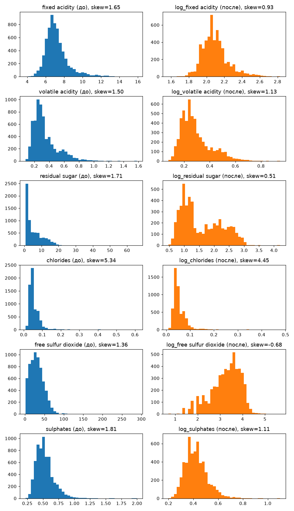

# Подготовка датасета Wine Quality

## 1. Выводы по анализу данных

Красное и белое вино объединены в одну таблицу (около 6,5 тыс. строк), добавлен признак `wine_type`. Пропусков нет, но есть полные дубликаты строк, их удаляем. Целевая переменная `quality` является целым числом от 3 до 9, классы несбалансированы: большинство вин получает оценки 5 и 6. Остальные 11 столбцов являются непрерывными физико-химическими измерениями, идентификаторов нет.

## 2. Какие столбцы приведены к корректным типам

- Все физико-химические измерения: к `float64` (с проверкой на нечисловые значения).
- `quality`: к `int64`.
- `wine_type`: к `category`.

## 3. Какие категориальные признаки закодированы

- `wine_type`: `is_white` (red = 0, white = 1). One-Hot не нужен: для двух категорий он дал бы два зеркальных столбца.
- `quality` не кодируем, это целевая переменная.

## 4. Какие числовые признаки преобразованы и почему

Правило: применяем `log1p`, если асимметрия (skew) больше 1 и значения неотрицательны. Преобразование оставляем, только если модуль skew после него уменьшился. Так `log1p` безопасен при нулевых значениях.

- Логарифмированы: `free sulfur dioxide`, `total sulfur dioxide`, `sulphates`, `alcohol` (и другие с правым хвостом, по результатам скрипта). Их среднее заметно больше медианы.
- Без преобразования: `density`, `pH`, `citric acid` — распределения близки к симметричным.

Прологарифмированные столбцы переименованы в `log_<имя>`.

## 5. Какие числовые признаки масштабированы

`StandardScaler` (среднее 0, стандартное отклонение 1) применён ко всем непрерывным признакам, включая логарифмированные, чтобы их шкалы стали сопоставимы.

## 6. Какие столбцы исключены и почему

- Не масштабированы: `is_white` (уже бинарный 0/1) и `quality` (целевая переменная).
- Ни один признак не удалён: идентификаторов и пропусков нет. Исходный текстовый `wine_type` заменён на `is_white`, исходные версии логарифмированных столбцов заменены на `log_`-версии.

## 7. Воспроизведение шагов

1. Загрузка и объединение двух файлов, добавление `wine_type`.
2. Приведение типов и удаление дубликатов.
3. Кодирование `wine_type` в `is_white`.
4. Логарифмирование по правилу skew > 1.
5. Масштабирование непрерывных признаков.
6. Проверки (нет пропусков и текста, mean ~= 0, std ~= 1) и сохранение.

## 8. Сравнение данных до и после обработки

# Итог для вас (чтобы быстро считать суть проекта)

Взяли данные по химии вин, выкинули дубликаты, превратили текст "red/white" в 0 и 1. Слишком скошенные распределения (где были аномальные выбросы) сгладили логарифмом, а затем всё это привели к единому масштабу (StandardScaler), чтобы показатели с большими значениями (например, общая сера ~200) не подавляли маленькие показатели (например, pH ~3). Теперь данные полностью готовы для условной линейной регрессии или логистической классификации.

## Ответы на вопросы:
1. **Почему для конкретного признака выбран One-Hot, а не Label или Frequency Encoding?**

    В датасете был всего один категориальный признак — wine_type (красное или белое вино). Применять для него One-Hot Encoding нет смысла, так как OHE создал бы два зеркальных столбца (is_red и is_white), которые на 100% коррелируют друг с другом. Для линейных моделей это вредно (вызывает мультиколлинеарность).
   Поэтому было сделано ручное бинарное кодирование в один столбец `is_white`, где 0 — красное, а 1 — белое.
  - Label Encoding здесь превратился бы в то же самое, но автоматическое присвоение чисел (например, 0 и 1) могло бы зависеть от порядка строк.
  - Frequency Encoding здесь бесполезен, так как частота встречаемости белого вина в выборке никак химически не связана с его качеством.
2. **Как вы определили асимметрию и почему выбрали именно этот вариант логарифмирования? Как вы определили асимметрию и почему выбрали именно этот вариант логарифмирования?**

   Асимметрию определялся математически с помощью метода .skew() из pandas. Был установлен строгий порог: если коэффициент асимметрии больше 1.0, распределение имеет сильный правый хвост (смещение в сторону больших выбросов). Дополнительно была проверена разница между средним и медианой.
   Вариант логарифмирования выбран `np.log1p()` (логарифм от x + 1) по двум причинам:
   1. Безопасность для нулей: В химических показателях вина могут быть нулевые значения (например, содержание какого-то сахара или кислот). Обычный np.log(0) выдаст минус бесконечность (-inf) и сломает обучение модели. np.log1p(0) равен 0, что сохраняет стабильность данных.
   2. Контроль качества: В коде прописано условие: исходный столбец заменяется на логарифмированный только в том случае, если модуль асимметрии после операции стал меньше, чем был до неё. Если логарифм не сделал распределение более симметричным, признак оставался без изменений.
3. **Какие столбцы исключили из итогового файла и чем они помешали бы модели?**

    Физически из датасета никакие уникальные признаки или строки не удалялись, так как в выборке не было ID-идентификаторов или столбцов с большим количеством пропусков. Однако из итогового файла были исключены исходные версии измененных столбцов:
   1. Исходный текстовый `wine_type`: Вместо него оставлен бинарный `is_white`. Текст удален, потому что алгоритмы машинного обучения (scikit-learn) работают только с числами, и строки вызвали бы ошибку ValueError при перемножении матриц.
   2. Оригинальные нелогарифмированные признаки (для тех, у которых уменьшали асимметрию). Если бы мы оставили в таблице одновременно и исходный признак, и его логарифм (log_...), мы бы получили мультиколлинеарность (сильную математическую зависимость между признаками). Это раздувает веса модели, делает линейные алгоритмы нестабильными и приводит к переобучению.
